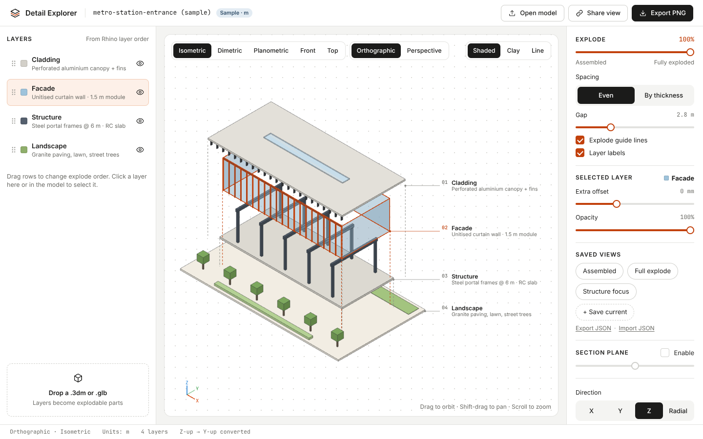

# Detail Explorer

A static web app that loads 3D architectural models exported from Rhino and pulls them apart
into an interactive **exploded axonometric**. Each Rhino layer becomes one explodable part.



- Opens `.3dm` (via three.js `3DMLoader` + rhino3dm WASM, bundled locally, no CDN) and `.glb` / `.gltf`
- Explode slider with layers that fully clear each other, Even / By thickness spacing, X / Y / Z / Radial
- Per-layer visibility, extra offset and opacity; drag rows to change the explode order
- Isometric, Dimetric, Planometric (true plan-oblique), Front and Top views, orthographic or perspective
- Shaded, Clay and Line render styles; glass stays translucent in all of them
- Dashed guide lines, numbered layer labels with leaders that never overlap, section plane
- PNG export at 2× / 4× (optional transparent background), shareable view links, saved views as JSON

Ships with a procedural **metro station entrance** (Cladding, Facade, Structure, Landscape), and the same
model as a real Rhino file at `public/models/station.3dm`.

## Run locally

Needs Node 20+.

```bash
npm install
```

```bash
npm run dev
```

Open the URL Vite prints (http://localhost:5173/Showitoff/). Other scripts:

| Script | What it does |
| --- | --- |
| `npm test` | Vitest unit tests (explode maths, label layout, view-state links, units, layer grouping) |
| `npm run build` | Type-checks and builds the static site into `dist/` |
| `npm run preview` | Serves `dist/` locally |
| `npm run sample:3dm` | Regenerates `public/models/station.3dm` from the sample, using rhino3dm in Node (needs Node 22.6+) |

`npm install` copies `rhino3dm.js` and `rhino3dm.wasm` from `node_modules/rhino3dm` into `public/rhino3dm/`
(`scripts/copy-rhino3dm.mjs`, which also runs before `dev` and `build`), so the deployed site never fetches
them from a CDN.

## Loading models

- **Drag and drop** a `.3dm`, `.glb` or `.gltf` anywhere on the window, or use **Open model**.
- **From the site**: put files in `public/models/` and open `?model=<file>`, for example
  `…/Showitoff/?model=station.3dm`. Only plain file names from that folder are accepted.
- `.gltf` files must be self-contained (embedded buffers and textures). Prefer `.glb`.

What happens on import:

- Rhino's Z-up is converted to three.js Y-up, model units are read from the file and scaled to metres,
  and the camera frames the fully exploded model.
- Geometry is grouped **by Rhino layer**, in the Rhino layer order (top of the Layers panel first).
  For glTF, each top-level node is a layer.
- Rhino render materials are kept. Objects without one use their display colour (object or layer colour).
- Breps and extrusions saved without render meshes can't be displayed; a message says how many were skipped.

## Exporting from Rhino

1. **One Rhino layer per explodable part.** Name the layers as you want them labelled
   (e.g. *Cladding, Facade, Structure, Landscape*) and order them top to bottom in the Layers panel.
   Sub-layers each become their own part.
2. **Save render meshes.** Switch a viewport to *Shaded* or *Rendered* so Rhino builds render meshes,
   then *File › Save As* with **Save small** unchecked. To be certain, run `_Mesh` on the objects and put
   the meshes on the same layers, or export `.glb` (*File › Export Selected › glTF Binary*).
3. **Check units** in *Document Properties › Units*. Millimetres, metres, feet and so on are all
   converted to metres; files with no units are treated as metres.
4. Glass reads best with a transparent render material (transparency of about 50–70%).

## Using the viewer

- Drag to orbit, Shift-drag (or right-drag) to pan, scroll to zoom. Press **E** to toggle explode.
- Click a layer row, or the layer in the 3D view, to select it. The selected layer gets an accent outline
  and its own **Extra offset** and **Opacity** sliders.
- Drag rows by the handle (or press Alt+↑/↓ on a focused row) to change the explode sequence.
- **Saved views**: *Assembled*, *Full explode*, *Structure focus* (ghosts everything except the layer named
  "Structure", or the selected layer), plus your own with **+ Save current**. Use **Export JSON** /
  **Import JSON** to move views between machines. A view stores camera, explode settings, order,
  per-layer offsets, visibility and opacity, render style and section plane.
- **Share view** copies a link with the whole view state in the URL hash. For dropped files the link holds the
  view only, so the recipient needs the same model; for `?model=` links it opens the model too.

### How the explode works

The logic lives in `src/core/explode.ts` (pure TypeScript, unit tested). Layers are taken in the panel order
with the bottom layer fixed. Going up the stack, each layer moves by

```
(overlap of its bounding box with the layer below + gap) × explode factor
```

on top of the layer below, so layers that share a height range (structure and facade are both full height)
clear each other completely at 100%. A layer is also pushed far enough to clear any other layer below it.
*By thickness* scales the gap by each layer's thickness. The whole model is shifted so the exploded stack
stays centred. *Radial* gives the same vertical clearance, split up and down from the middle, and also pushes
off-centre layers outward. Changes animate with an ease-in-out over 250 ms.

## Deploying to GitHub Pages

`vite.config.ts` sets `base: '/Showitoff/'` (the repository name) so assets resolve under
`https://<user>.github.io/Showitoff/`. If you rename the repository, change it there, or build with
`BASE_PATH=/ npm run build` for a root or custom domain.

1. Push to GitHub.
2. In the repository, open **Settings › Pages** and set **Source** to **GitHub Actions**.
3. Push to `main`. `.github/workflows/deploy.yml` installs, tests, builds and deploys with
   `actions/upload-pages-artifact` and `actions/deploy-pages`. You can also run it by hand from the Actions tab.

## Project layout

```
src/core/          pure, tested logic: explode maths, label layout, view state + URL hash, units
src/loaders/       3DM and glTF loaders, layer grouping
src/sample/        procedural metro station entrance
src/viewer/        three.js viewer: cameras and presets, render styles, guides, labels, gizmo, export
src/ui/            layer panel
src/main.ts        app state and UI wiring
scripts/           rhino3dm copy step, sample .3dm generator
```
